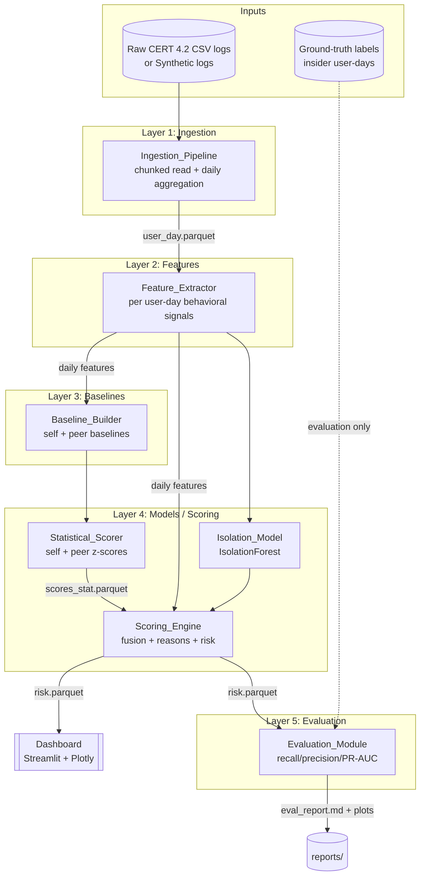
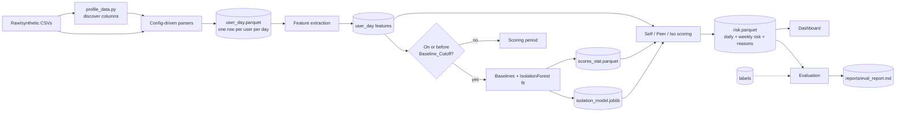

# Design Document

## Overview

The UEBA Insider Threat Detection system learns each user's normal behavior during a baseline period, scores later days against that baseline, ranks users by risk, explains why each user was flagged, and measures detection quality against the CMU/SEI CERT release 4.2 ground-truth labels. It runs entirely offline in Python 3.11 with no cloud services and no runtime network calls.

The design follows a strict top-to-bottom data flow across five processing layers plus two inputs and two outputs. Raw event logs enter at ingestion and flow down through feature extraction, baseline computation, and scoring. Scoring feeds both the Streamlit dashboard and the evaluation harness. Ground-truth labels are a second input that enters the pipeline **only** at the evaluation layer, never at training or feature computation.

Three design rules dominate every decision:

1. **Profile before parsing.** Column names and layouts are discovered from the real CSVs by the Data_Profiler and read through config-driven parsers. No column name is hard-coded.
2. **Split by time, never randomly.** Baselines and the IsolationForest train only on baseline-period user-days. Scoring happens on later days. This preserves the temporal integrity that makes anomaly detection meaningful.
3. **Labels are evaluation-only.** No label touches a feature, a baseline, or a model. This keeps the detector honest.

A synthetic log generator reproduces the dataset schema so the full pipeline, tests, and demo run without the 20 GB download.

### Technology Stack

| Concern | Choice | Reason |
| --- | --- | --- |
| Language | Python 3.11 | Project constraint; strong data ecosystem |
| Chunked data processing | pandas + DuckDB / pyarrow | Stream large CSVs without loading them whole |
| Columnar storage | Parquet (pyarrow) | Compact, typed, fast re-reads of user-day artifacts |
| Anomaly model | scikit-learn IsolationForest | Unsupervised, robust to unlabeled behavioral data |
| Dashboard | Streamlit + Plotly | Fast interactive analyst UI, no web stack to maintain |
| Config | PyYAML (`config.yaml`) | All paths, windows, site lists, and weights in one file |
| Testing | pytest (+ Hypothesis for property tests) | Per-phase unit tests and universal property checks |

## Architecture

### System Architecture (5 layers, 2 inputs)



Logs flow down through ingestion, features, and baselines into scoring. The Scoring_Engine also reads daily features directly (for the IsolationForest and for reason records) rather than only through baselines. Scoring feeds both the dashboard and the evaluation harness. The dashed edge from labels marks the single, deliberate entry point for ground truth: evaluation only.

### Data Flow



### Folder Structure

```
CIS/
├── config.yaml                 # all paths, windows, site lists, weights
├── requirements.txt
├── README.md                   # setup + run on synthetic data
├── .gitignore                  # excludes data/
├── app.py                      # Streamlit dashboard entry point
├── scripts/
│   ├── profile_data.py         # Data_Profiler: inspect raw CSVs first
│   └── generate_synthetic.py   # Synthetic_Generator
├── src/ueba/
│   ├── __init__.py
│   ├── config.py               # typed config loader
│   ├── ingestion/              # chunked read + daily aggregation
│   ├── features/               # per-user-day feature extraction
│   ├── baselines/              # self + peer baselines, cutoff logic
│   ├── models/                 # IsolationForest train/save/load
│   ├── scoring/                # z-scores, fusion, reason records
│   └── evaluation/             # metrics, variant comparison, report
├── tests/                      # pytest unit + property tests per phase
├── docs/
│   ├── ARCHITECTURE.md         # mermaid, feature table, formula, results
│   └── DEMO.md                 # how to run the demo
├── reports/                    # eval_report.md + plots (generated)
└── data/                       # raw/ + processed/  (git-ignored)
    ├── raw/
    └── processed/
```

## Components and Interfaces

### Data_Profiler (`scripts/profile_data.py`)

Runs first, before any parser is written. Reads each raw CSV in chunks and reports its structure so parsers are derived from reality, not assumptions.

- `profile_directory(raw_dir: str) -> list[FileProfile]` — inspects every CSV.
- `FileProfile` fields: `filename`, `columns: list[str]`, `row_count: int`, `date_range: tuple[date, date]`.
- Side effect: prints header, row count, and date range per file.

Plain-English: *This tool opens each raw file and tells us its column names, how many rows it has, and the span of dates it covers, so we never guess at the data's shape.*

### Config loader (`src/ueba/config.py`)

Single typed access point for `config.yaml`. Everything configurable is read here; no module hard-codes a path, a column name, a window, or a weight.

```python
@dataclass(frozen=True)
class Config:
    raw_data_dir: str
    processed_dir: str
    working_hours: WorkingHours        # start_hour, end_hour
    weekend_days: list[int]            # e.g. [5, 6]
    site_categories: SiteCategories    # job_sites, upload_leak_sites
    weights: FusionWeights             # self_w, iso_w, peer_w
    baseline: BaselineConfig           # min_days, max_days, target_days
    subset: SubsetConfig               # normal_sample_size
    column_map: dict[str, dict]        # logical name -> source column per file type

def load_config(path: str = "config.yaml") -> Config: ...
```

Plain-English: *One file holds every setting. Change the working-hours window or the scoring weights there, and the whole system follows.*

### Synthetic_Generator (`scripts/generate_synthetic.py`)

Generates event CSVs matching the CERT 4.2 schema and can plant anomalies.

- `generate(out_dir, n_users, n_days, seed) -> None` — writes schema-matching CSVs.
- `plant_anomaly(user_id, day, kind) -> None` — injects a measurable spike (e.g. USB burst, after-hours logons) for a user on a day.

Plain-English: *A stand-in data factory. It makes realistic logs in the same format as the real dataset so we can test and demo without the 20 GB download, and it can deliberately create suspicious days to prove the detector catches them.*

### Ingestion_Pipeline (`src/ueba/ingestion/`)

- `ingest(config: Config) -> pd.DataFrame` — chunked read of every raw CSV, aggregate to one row per `(user, calendar_day)`, drop null-user rows, restrict to the Subset, write `user_day.parquet`.
- `select_subset(users, insiders, sample_size, seed) -> set[str]` — all insiders plus ~`sample_size` sampled normals.

Reads in chunks (DuckDB/pyarrow) so no raw file is loaded whole. Emits exactly one `User_Day` per user per active day.

Plain-English: *Reads the mountain of raw events a slice at a time and boils them down to one tidy row per person per day.*

### Feature_Extractor (`src/ueba/features/`)

Computes per-user-day behavioral features from ingested events, classifying after-hours activity and site categories strictly by config values.

- `extract_features(user_day_events, config) -> pd.DataFrame`

Feature families (see Data Models for the full table): logon, USB/removable-media, web, and email counts.

Plain-English: *Turns each person's daily activity into a row of numbers — logons, USB use, web uploads, emails — that describe how they behaved that day.*

### Baseline_Builder (`src/ueba/baselines/`)

- `baseline_cutoff(user_history) -> date` — first 60–90 days of activity, minimum 30.
- `build_self_baseline(features_in_period) -> per-user mean/std`
- `build_peer_baseline(features_in_period, roles) -> per-role mean/std`

Uses only user-days inside the Baseline_Period. Out-of-period rows never affect a baseline.

Plain-English: *Learns what "normal" looks like for each person (and for their job-role group) using only their early history.*

### Statistical_Scorer (`src/ueba/scoring/statistical.py`)

- `self_score(user_day, self_baseline) -> float` — per-feature z vs own baseline, cap each |z| at 5, score = mean of top-3 z scaled to 0–1 (divide by 5).
- `peer_score(user_day, peer_baseline) -> float` — same against role-group baseline.
- Writes `scores_stat.parquet`.

Plain-English: *Measures how far a day stands out from the person's own normal and from their peers, keeping the three biggest surprises.*

### Isolation_Model (`src/ueba/models/`)

- `train(baseline_features) -> IsolationForest` — fits on user-days dated on or before the Baseline_Cutoff only; features scaled to 0–1.
- `save(model, path)` / `load(path)` — persist and reload.
- `score(model, user_days) -> np.ndarray` — raw anomaly scores.

Plain-English: *A machine-learned detector trained only on calm, early-period behavior so it can flag days that don't fit the learned pattern.*

### Scoring_Engine (`src/ueba/scoring/engine.py`)

- `scale_isolation(raw_scores) -> 0..1`
- `daily_risk(self_s, iso_s, peer_s, weights) -> float` — `100 * (w_self*self + w_iso*iso + w_peer*peer)`.
- `weekly_risk(daily_series) -> float` — trailing-7 sum per user.
- `reason_record(user_day, baselines) -> top-3 features` — each with value, baseline mean, z-score.
- Writes `risk.parquet`.

Plain-English: *Combines the three signals into one 0–100 daily risk, rolls it into a weekly score, and records the top three reasons a day looked risky.*

### Evaluation_Module (`src/ueba/evaluation/`)

- `recall_at_k(ranking, labels, k)`, `precision_at_k(ranking, labels, k)` — user level (k = 20, 50).
- `pr_auc(scores, labels)` — user-day level.
- `compare_variants(...)` — z-only, iso-only, fused side by side.
- `write_report(results, out="reports/eval_report.md")` — markdown plus Plotly/Matplotlib plots. Runs from a single command. Never reports plain accuracy. Consumes labels here and nowhere else.

Plain-English: *Grades the detector against the known answers, comparing the three scoring recipes, and writes a report with charts — without ever leaking the answers into the detector.*

### Dashboard (`app.py`)

- Ranked users by Weekly_Risk; date control and risk-threshold control.
- User drill-down: daily-risk timeline and a why-flagged panel (feature value vs baseline).
- Alerts-per-day view. Loads the Subset interactively within 10 seconds (reads pre-computed `risk.parquet`, no heavy compute at render time).

Plain-English: *The analyst's screen: who's risky this week, when, why, and how many alerts fired each day.*

## Data Models

### `user_day.parquet` — one row per user per day

| Column | Type | Description |
| --- | --- | --- |
| `user` | string | User identifier (never null) |
| `day` | date | Calendar day |
| `role` | string | Role/group for peer baseline |
| `logon_count` | int | Logons that day |
| `after_hours_logon_count` | int | Logons outside working hours |
| `weekend_logon_count` | int | Logons on weekend days |
| `distinct_machines` | int | Distinct machines used |
| `usb_connect_count` | int | USB/removable-media connects |
| `after_hours_usb_count` | int | After-hours USB connects |
| `files_to_removable` | int | Files copied to removable media |
| `job_site_visits` | int | Visits to configured job sites |
| `upload_leak_site_visits` | int | Visits to configured upload/leak sites |
| `file_upload_count` | int | File uploads |
| `distinct_domains` | int | Distinct web domains |
| `total_web_requests` | int | Total web requests |
| `emails_sent` | int | Emails sent |
| `external_recipients` | int | External recipients |
| `email_attachments` | int | Attachments sent |

The feature columns are exactly Requirement 4's families: logon (4.1), USB (4.2), web (4.3), and email (4.4). After-hours and site-category columns are derived using config windows and lists (4.5).

### `scores_stat.parquet`

| Column | Type | Description |
| --- | --- | --- |
| `user` | string | User identifier |
| `day` | date | Calendar day |
| `self_score` | float | Self anomaly score, 0–1 |
| `peer_score` | float | Peer anomaly score, 0–1 |
| `self_top_features` | list<struct> | Top-3 self features with z-scores |
| `peer_top_features` | list<struct> | Top-3 peer features with z-scores |

### `risk.parquet`

| Column | Type | Description |
| --- | --- | --- |
| `user` | string | User identifier |
| `day` | date | Calendar day |
| `self_score` | float | 0–1 |
| `isolation_score` | float | 0–1 |
| `peer_score` | float | 0–1 |
| `daily_risk` | float | 0–100 |
| `weekly_risk` | float | Trailing-7 sum of daily_risk |
| `reasons` | list<struct> | Reason_Record: up to 3 structs of `{feature, value, baseline_mean, z_score}` |

Saved model: `isolation_model.joblib` under `data/processed/`.

### Scoring Algorithm

```mermaid
flowchart TD
    UD[User_Day features] --> SELF[Self z-scores vs own baseline]
    UD --> PEER[Peer z-scores vs role baseline]
    UD --> ISOIN[Scale features 0-1]

    SELF --> CAPS[Cap each |z| at 5]
    PEER --> CAPP[Cap each |z| at 5]
    CAPS --> T3S[Mean of top-3 z / 5 = self_score 0-1]
    CAPP --> T3P[Mean of top-3 z / 5 = peer_score 0-1]

    ISOIN --> ISOM[IsolationForest<br/>trained on baseline only]
    ISOM --> ISOS[Scale to iso_score 0-1]

    T3S --> FUSE
    ISOS --> FUSE
    T3P --> FUSE
    FUSE["daily_risk = 100 * (0.5*self + 0.3*iso + 0.2*peer)<br/>weights from config"]
    FUSE --> WEEK["weekly_risk = sum of last 7 daily_risk"]
    CAPS --> REASON["Reason_Record:<br/>top-3 features {value, baseline_mean, z}"]
```

Worked numeric example with default weights: `self_score = 0.8`, `iso_score = 0.6`, `peer_score = 0.4` →
`daily_risk = 100 * (0.5*0.8 + 0.3*0.6 + 0.2*0.4) = 100 * (0.40 + 0.18 + 0.08) = 66.0`.

### Config Schema (`config.yaml`)

```yaml
paths:
  raw_data_dir: data/raw          # Requirement 1.4: never hard-coded
  processed_dir: data/processed

working_hours:
  start_hour: 8                   # inclusive
  end_hour: 18                    # exclusive; outside = after-hours
weekend_days: [5, 6]              # Saturday, Sunday (Mon=0)

site_categories:
  job_sites:                      # Requirement 4.3 / 4.5
    - job-hunt.org
    - careerbuilder.com
  upload_leak_sites:
    - wikileaks.org
    - dropbox.com

weights:                          # Requirement 6.5; must sum to 1.0
  self_w: 0.5
  iso_w: 0.3
  peer_w: 0.2

baseline:
  min_days: 30                    # Requirement 5.2
  target_days: 75                 # first 60-90 days
  max_days: 90

subset:
  normal_sample_size: 300         # Requirement 2.6; all insiders added automatically
  seed: 42

column_map:                       # filled in AFTER profiling; logical -> source column
  logon:   { user: user, date: date, pc: pc, activity: activity }
  device:  { user: user, date: date, pc: pc, activity: activity }
  http:    { user: user, date: date, url: url }
  email:   { user: user, date: date, to: to, attachments: attachments, size: size }
```

## Error Handling

- **Missing or unprofiled columns:** the config loader validates that every logical name in `column_map` resolves against the profiled headers; a missing mapping raises a clear configuration error naming the file type and logical field, rather than failing deep in parsing.
- **Null user identifiers:** dropped during ingestion before aggregation; they never reach `user_day.parquet` and never affect counts.
- **Short user histories:** if a user has fewer than `min_days` of activity, the Baseline_Builder flags the user as having an insufficient baseline and excludes them from scoring rather than producing unstable z-scores.
- **Zero-variance baseline features:** when a feature's baseline standard deviation is 0, the z-score is defined as 0 (no deviation signal) to avoid division by zero.
- **Weights not summing to 1.0:** the config loader rejects fusion weights that do not sum to 1.0 within tolerance.
- **Missing artifacts at dashboard start:** if `risk.parquet` is absent, the dashboard shows an actionable message to run the pipeline rather than crashing.
- **Empty label set at evaluation:** PR-AUC and recall/precision degrade gracefully (defined as 0 or NaN with a warning) when no positive labels exist, keeping the report generatable.
- **Offline guarantee:** no component opens a network socket at runtime; synthetic generation and all processing are local.

## Correctness Properties

*A property is a characteristic or behavior that should hold true across all valid executions of a system — essentially, a formal statement about what the system should do. Properties serve as the bridge between human-readable specifications and machine-verifiable correctness guarantees.*

### Property 1: Data_Profiler reports match ground truth

For any raw CSV with an arbitrary header, row set, and date column, the Data_Profiler SHALL report a row count equal to the true number of rows, a column list equal to the true header, and a date range equal to the true minimum and maximum dates.

**Validates: Requirements 1.3**

### Property 2: Aggregation yields exactly one record per user-day

For any set of input events, `user_day.parquet` SHALL contain exactly one record for each distinct non-null `(user, calendar_day)` pair present in the input and no others, with no duplicate pairs.

**Validates: Requirements 2.2, 2.4**

### Property 3: Null-user events are excluded without side effects

For any input event set, records with a null user identifier SHALL NOT appear in `user_day.parquet`, and their removal SHALL NOT change any surviving user-day's feature counts.

**Validates: Requirements 2.5**

### Property 4: Subset includes every insider

For any user population and insider set, the ingested Subset SHALL include every insider user and approximately the configured number of sampled normal users.

**Validates: Requirements 2.6**

### Property 5: Artifact persistence round-trips

For any aggregated frame written to `user_day.parquet`, `scores_stat.parquet`, or `risk.parquet`, reading the file back SHALL produce a frame equal to the one written.

**Validates: Requirements 2.3, 5.5, 6.8**

### Property 6: Synthetic logs match the dataset schema

For any generation parameters, every file produced by the Synthetic_Generator SHALL have columns matching the declared CERT 4.2 schema for that file type.

**Validates: Requirements 3.1**

### Property 7: Planted anomalies create measurable deviation

For any user and day, when the Synthetic_Generator plants an anomaly, the affected feature on that user-day SHALL exceed the user's baseline distribution for that feature.

**Validates: Requirements 3.2, 5.6**

### Property 8: Feature counts equal independently derived truth

For any generated event set, each computed feature (logon, after-hours logon, weekend logon, distinct machines, USB connects, after-hours USB, files to removable, job-site visits, upload/leak-site visits, uploads, distinct domains, total web requests, emails sent, external recipients, attachments) SHALL equal the count derived independently from the input events.

**Validates: Requirements 4.1, 4.2, 4.3, 4.4**

### Property 9: Classification follows config

For any event timestamp and any configured working-hours window and site-category lists, the after-hours flag SHALL equal whether the timestamp falls outside the window, and the site category SHALL equal membership in the configured lists.

**Validates: Requirements 4.5**

### Property 10: Baselines depend only on in-period user-days

For any user history, changing or removing user-days outside the Baseline_Period SHALL NOT change that user's baseline, while the baseline SHALL reflect in-period user-days.

**Validates: Requirements 5.1**

### Property 11: Baseline window respects bounds

For any user history, the selected Baseline_Period SHALL start at the user's first activity and span a length within 30 to 90 days.

**Validates: Requirements 5.2**

### Property 12: Statistical score invariants hold for self and peer

For any user-day and baseline (own or role-group), each feature z-score SHALL be capped at 5, and the resulting score SHALL equal the mean of the top-3 capped z-scores scaled into the range 0 to 1.

**Validates: Requirements 5.3, 5.4**

### Property 13: IsolationForest trains only on baseline-period records

For any set of dated user-days, the Isolation_Model training set SHALL contain exactly the records dated on or before the Baseline_Cutoff and SHALL exclude every record dated after it.

**Validates: Requirements 6.1, 6.2**

### Property 14: Isolation score is bounded

For any user-day, the Isolation_Score SHALL lie within the range 0 to 1.

**Validates: Requirements 6.3**

### Property 15: Daily risk equals the configured weighted fusion

For any self, isolation, and peer scores in 0 to 1 and any configured weights, Daily_Risk SHALL equal 100 times the weighted sum of the three scores using those weights, and SHALL lie within 0 to 100.

**Validates: Requirements 6.4, 6.5**

### Property 16: Weekly risk equals the trailing-7 daily sum

For any per-user series of Daily_Risk values, Weekly_Risk SHALL equal the sum of the last seven Daily_Risk values.

**Validates: Requirements 6.6**

### Property 17: Reason records are the true top-3 contributors

For any user-day, the Reason_Record SHALL contain the (up to) three features with the highest z-scores, each with its correct value, baseline mean, and z-score.

**Validates: Requirements 6.7**

### Property 18: Saved and reloaded model score identically

For any set of user-days, scoring with the reloaded Isolation_Model SHALL produce the same scores as the in-memory model.

**Validates: Requirements 6.10**

### Property 19: Evaluation metrics match reference computation

For any user-level ranking with labels, recall@20, recall@50, and precision@20 SHALL equal their reference definitions; and for any user-day scores with labels, PR-AUC SHALL equal its reference computation and lie within 0 to 1.

**Validates: Requirements 7.2, 7.3**

### Property 20: Users are ranked by descending weekly risk

For any risk data, the dashboard ranking SHALL order users so that Weekly_Risk is non-increasing from top to bottom.

**Validates: Requirements 8.1**

### Property 21: Drill-down data matches stored data

For any selected user, the daily-risk timeline SHALL equal that user's Daily_Risk values in date order, and the why-flagged panel SHALL equal that user-day's stored Reason_Record fields.

**Validates: Requirements 8.3, 8.4, 8.7**

### Property 22: Alerts-per-day matches the threshold definition

For any risk data and threshold, the alerts-per-day count for each day SHALL equal the number of user-days on that day whose Daily_Risk is at or above the threshold.

**Validates: Requirements 8.5**

## Testing Strategy

The system is delivered in seven sequential phases. Each phase ships its own unit and property tests, and the next phase does not begin until the current phase's tests pass. All tests run against Synthetic_Generator output so the suite never needs the raw dataset. Property tests use Hypothesis with a minimum of 100 iterations and are tagged `Feature: ueba-insider-threat-detection, Property {number}: {property_text}`.

**Dual approach:** property tests verify the universal properties above across many generated inputs; example, edge-case, smoke, and integration tests cover specific scenarios, structure, and wiring.

### Phase-to-acceptance mapping

| Phase | Scope | Acceptance checks | Tests |
| --- | --- | --- | --- |
| 1. Setup & profiling | Project skeleton, config, `profile_data.py`, pytest green | 1.1–1.6, 10.3 | Smoke: structure present, config keys, `.gitignore` excludes `data/`, network-blocked run. Property 1 (profiler reports). |
| 2. Ingestion + synthetic | Chunked read, daily aggregation, subset, generator | 2.1–2.7, 3.1–3.3 | Property 2, 3, 4, 5 (user_day), 6, 7. Example: chunked-reader path taken. Integration: generator → ingestion pipeline. |
| 3. Features, baselines, stat scoring | Feature extraction, baselines, self/peer z-scores | 4.1–4.5, 5.1–5.6 | Property 8, 9, 10, 11, 12, 5 (scores_stat). Edge: planted USB spike z > 4. |
| 4. IsolationForest + fusion | Train on baseline only, scale, fuse, reasons, persist | 6.1–6.10 | Property 13, 14, 15, 16, 17, 18, 5 (risk). Smoke: model file saved. |
| 5. Evaluation | Metrics, variant comparison, report | 7.1–7.7 | Property 19. Example: three variants present, no accuracy, report + plots exist. Example: labels never reach features/model. Integration: single-command report. |
| 6. Dashboard | Ranking, controls, drill-down, alerts, performance | 8.1–8.7 | Property 20, 21, 22. Example: controls render. Integration: < 10s load on Subset. |
| 7. Docs & demo polish | ARCHITECTURE, DEMO, README, per-module explanations | 9.1–9.5, 10.1–10.2 | Smoke: required docs/sections present, per-phase tests exist. Integration: fresh-clone demo launches dashboard on synthetic data. |

### Test classification summary

- **Property tests (universal):** Properties 1–22 above, each ≥ 100 iterations.
- **Example tests:** config path resolution (1.4), chunked-reader usage (2.1), label isolation (7.1), report contents and variant presence (7.4, 7.5, 7.7), dashboard controls (8.2), insider reasons (8.7).
- **Edge-case tests:** planted USB spike threshold (5.6), zero-variance baseline, short-history users, empty label set.
- **Smoke tests:** project structure (1.1), config keys (1.2), `.gitignore` (1.5), pytest green (1.6), model saved (6.9), docs present (9.1–9.4), phase plan and per-phase tests (10.1, 10.2).
- **Integration tests:** end-to-end synthetic pipeline (3.3), single-command evaluation (7.6), dashboard load time (8.6), fresh-clone demo (9.5), no-network run (10.3).
