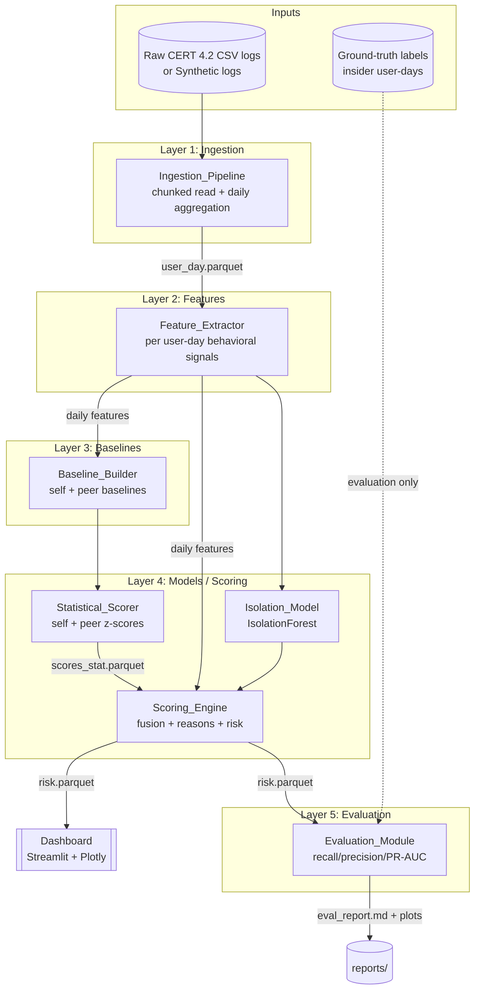
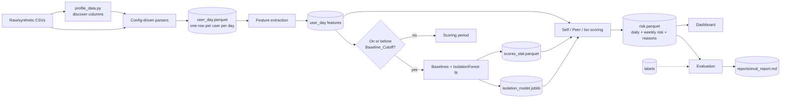

# Architecture — UEBA Insider Threat Detection

This document is the standalone technical reference for the UEBA Insider Threat
Detection system. It covers the system context, the five processing layers, the
end-to-end data flow, the folder layout, the full behavioral feature table, the
scoring formula and final weights, the evaluation methodology and results, and
the system's honest limitations. It is written to be read on its own — for a
report or a viva — without cross-referencing the spec.

The system learns each user's normal behavior during a baseline period, scores
later days against that baseline, ranks users by risk, explains why each user
was flagged, and measures detection quality against the CMU/SEI CERT Insider
Threat Test Dataset release 4.2 ground-truth labels. It runs entirely offline in
Python 3.11 with no cloud services and no runtime network calls.

Three rules dominate every design decision:

1. **Profile before parsing.** Column names and layouts are discovered from the
   real CSVs by the Data_Profiler and read through config-driven parsers. No
   column name is hard-coded.
2. **Split by time, never randomly.** Baselines and the IsolationForest train
   only on baseline-period user-days. Scoring happens on later days. This
   preserves the temporal integrity that makes anomaly detection meaningful.
3. **Labels are evaluation-only.** No label touches a feature, a baseline, or a
   model. This keeps the detector honest.

A synthetic log generator reproduces the dataset schema so the full pipeline,
tests, and demo run without the 20 GB download.

---

## 1. System Architecture (5 layers, 2 inputs)

Raw event logs enter at ingestion and flow down through feature extraction,
baseline computation, and scoring. Scoring feeds both the Streamlit dashboard
and the evaluation harness. Ground-truth labels are a **second input** that
enters the pipeline only at the evaluation layer — never at training or feature
computation (the dashed edge below).



The five layers, top to bottom:

| Layer | Component | Responsibility |
| --- | --- | --- |
| 1. Ingestion | `Ingestion_Pipeline` | Chunked read of raw CSVs; aggregate to one row per `(user, day)`; drop null users; restrict to the Subset |
| 2. Features | `Feature_Extractor` | Turn each user-day's events into 15 behavioral counts |
| 3. Baselines | `Baseline_Builder` | Learn per-user and per-role "normal" from baseline-period days only |
| 4. Models / Scoring | `Statistical_Scorer` + `Isolation_Model` + `Scoring_Engine` | Self/peer z-scores, IsolationForest anomaly scores, fusion into daily/weekly risk + reasons |
| 5. Evaluation | `Evaluation_Module` | recall@k, precision@k, PR-AUC; compare z-only / iso-only / fused; write report |

The dashboard reads the pre-computed `risk.parquet` and does no heavy compute at
render time, so the Subset becomes interactive within ten seconds.

### Technology stack

| Concern | Choice | Reason |
| --- | --- | --- |
| Language | Python 3.11 | Project constraint; strong data ecosystem |
| Chunked data processing | pandas + DuckDB / pyarrow | Stream large CSVs without loading them whole |
| Columnar storage | Parquet (pyarrow) | Compact, typed, fast re-reads of user-day artifacts |
| Anomaly model | scikit-learn IsolationForest | Unsupervised, robust to unlabeled behavioral data |
| Dashboard | Streamlit + Plotly | Fast interactive analyst UI, no web stack to maintain |
| Config | PyYAML (`config.yaml`) | All paths, windows, site lists, and weights in one file |
| Testing | pytest (+ Hypothesis for property tests) | Per-phase unit tests and universal property checks |

---

## 2. Data Flow (raw logs → dashboard)

The time-based split is explicit in the flow: user-days dated on or before the
`Baseline_Cutoff` train the baselines and the IsolationForest; later days are
scored against them. Labels join only at the evaluation step.



Artifacts produced along the way:

- `data/processed/user_day.parquet` — one aggregated row per user per active day.
- `data/processed/scores_stat.parquet` — self/peer scores with top-feature records.
- `data/processed/isolation_model.joblib` — the trained IsolationForest.
- `data/processed/risk.parquet` — fused daily risk, weekly risk, and reasons.
- `reports/eval_report.md` + plots — detection-quality results.

---

## 3. Folder Structure

```
CIS/
├── config.yaml                 # all paths, windows, site lists, weights
├── requirements.txt
├── README.md                   # setup + run on synthetic data
├── .gitignore                  # excludes data/
├── app.py                      # Streamlit dashboard entry point
├── scripts/
│   ├── profile_data.py         # Data_Profiler: inspect raw CSVs first
│   ├── generate_synthetic.py   # Synthetic_Generator
│   └── run_eval.py             # single-command evaluation report
├── src/ueba/
│   ├── __init__.py
│   ├── config.py               # typed config loader
│   ├── ingestion/              # chunked read + daily aggregation
│   ├── features/               # per-user-day feature extraction
│   ├── baselines/              # self + peer baselines, cutoff logic
│   ├── models/                 # IsolationForest train/save/load
│   ├── scoring/                # z-scores, fusion, reason records
│   ├── evaluation/             # metrics, variant comparison, report
│   └── dashboard/              # dashboard data-prep logic used by app.py
├── tests/                      # pytest unit + property tests per phase
├── docs/
│   ├── ARCHITECTURE.md         # this document
│   └── DEMO.md                 # how to run the demo
├── reports/                    # eval_report.md + plots (generated)
└── data/                       # raw/ + processed/  (git-ignored)
    ├── raw/
    └── processed/
```

The dashboard's heavy lifting (loading and shaping `risk.parquet`) lives in
`src/ueba/dashboard/` so `app.py` stays a thin Streamlit entry point that renders
pre-computed data.

---

## 4. Behavioral Feature Table

The `Feature_Extractor` turns each user-day's raw events into 15 numeric
features across four families. After-hours and site-category classifications are
driven strictly by `config.yaml` (the working-hours window and the site lists),
never hard-coded. One row per `(user, day)` is written to `user_day.parquet`.

| # | Feature | Family | Source (CERT 4.2 file) | Rationale |
| --- | --- | --- | --- | --- |
| 1 | `logon_count` | Logon | logon.csv | Volume of logon activity; a baseline for daily presence |
| 2 | `after_hours_logon_count` | Logon | logon.csv | Logons outside the configured working-hours window — classic insider signal |
| 3 | `weekend_logon_count` | Logon | logon.csv | Weekend presence (config `weekend_days`) often flags unusual access |
| 4 | `distinct_machines` | Logon | logon.csv | Lateral movement / credential sharing across many hosts |
| 5 | `usb_connect_count` | USB / removable | device.csv | Removable-media use is the primary data-exfiltration vector |
| 6 | `after_hours_usb_count` | USB / removable | device.csv | USB use outside working hours is more suspicious than during the day |
| 7 | `files_to_removable` | USB / removable | file.csv | Files copied to removable media — direct exfiltration evidence |
| 8 | `job_site_visits` | Web | http.csv | Job-hunting sites (config `job_sites`) correlate with flight-risk insiders |
| 9 | `upload_leak_site_visits` | Web | http.csv | Visits to upload/leak sites (config `upload_leak_sites`) |
| 10 | `file_upload_count` | Web | http.csv | Web uploads — another exfiltration channel |
| 11 | `distinct_domains` | Web | http.csv | Breadth of browsing; spikes can indicate reconnaissance |
| 12 | `total_web_requests` | Web | http.csv | Overall web volume; a baseline for the web family |
| 13 | `emails_sent` | Email | email.csv | Volume of outbound email |
| 14 | `external_recipients` | Email | email.csv | Mail leaving the organization — exfiltration via email |
| 15 | `email_attachments` | Email | email.csv | Attachments to outbound mail carry the payload |

The after-hours features (#2, #6) use the config working-hours window
(`start_hour` inclusive, `end_hour` exclusive); the weekend feature (#3) uses
`weekend_days`; and the two site features (#8, #9) use the configured site
lists. Changing any of these in `config.yaml` changes the classification with no
code change.

> **Honest note on `files_to_removable` (#7).** This feature is sourced from
> `file.csv` in the real CERT 4.2 dataset. The project's Synthetic_Generator
> emits only the logon, device, http, and email files — it does **not** emit a
> `file.csv`. Consequently, on synthetic data `files_to_removable` is always
> `0` and contributes no signal. The feature is retained in the schema so the
> pipeline is ready for the real dataset, but every result produced on synthetic
> data should be read with this gap in mind. See Limitations.

---

## 5. Scoring Formula and Final Weights

Scoring fuses three independent opinions about each user-day — how unusual the
day is versus the user's own history (self), versus their role peers (peer), and
versus a machine-learned anomaly model (isolation) — into a single explainable
`Daily_Risk` in 0–100.

```mermaid
flowchart TD
    UD[User_Day features] --> SELF[Self z-scores vs own baseline]
    UD --> PEER[Peer z-scores vs role baseline]
    UD --> ISOIN[Scale features 0-1]

    SELF --> CAPS[Cap each |z| at 5]
    PEER --> CAPP[Cap each |z| at 5]
    CAPS --> T3S[Mean of top-3 z / 5 = self_score 0-1]
    CAPP --> T3P[Mean of top-3 z / 5 = peer_score 0-1]

    ISOIN --> ISOM[IsolationForest<br/>trained on baseline only]
    ISOM --> ISOS[Min-max scale to iso_score 0-1]

    T3S --> FUSE
    ISOS --> FUSE
    T3P --> FUSE
    FUSE["daily_risk = 100 * (0.5*self + 0.3*iso + 0.2*peer)"]
    FUSE --> WEEK["weekly_risk = sum of trailing-7 daily_risk rows"]
    CAPS --> REASON["Reason_Record:<br/>top-3 features {value, baseline_mean, z}"]
```

### 5.1 Self score and peer score

For each user-day feature, a z-score is computed against a baseline mean and
standard deviation:

```
z_i = (value_i − baseline_mean_i) / baseline_std_i
```

- **Self score** uses the user's *own* baseline; **peer score** uses the user's
  *role-group* baseline.
- Each `|z_i|` is **capped at 5** to stop a single extreme feature from
  dominating.
- The score is the **mean of the top-3 capped z-scores, scaled to 0–1 by
  dividing by 5**:

```
score = mean(top3(|z| capped at 5)) / 5        # in [0, 1]
```

- When a baseline feature's standard deviation is 0 (no variation in the
  baseline period), its z-score is defined as 0 to avoid division by zero.

### 5.2 Isolation score (min-max scaling)

The IsolationForest, trained only on baseline-period user-days, emits an
unbounded raw anomaly score (higher = more anomalous). The `Scoring_Engine`
turns it into a bounded `isolation_score` in 0–1 using a deterministic **min-max
transform over the batch being scored**:

```
iso_score = (raw − raw.min()) / (raw.max() − raw.min())      # clamped to [0, 1]
```

This maps the least anomalous day in the batch to 0 and the most anomalous to 1
while preserving the forest's ordering, and it needs no trained parameters.

> **Degenerate case.** When every raw score in the batch is identical
> (`max == min`), the transform is undefined; the engine then assigns the whole
> batch a neutral `0.5`. The scaling is therefore **relative to the scored
> batch** — this is intended and documented behavior, but it means an isolation
> score is only meaningful relative to the other days scored at the same time.

### 5.3 Fusion — final weights

`Daily_Risk` is the weighted sum of the three 0–1 scores, scaled to 0–100, with
weights read from `config.yaml` (they must sum to 1.0):

```
daily_risk = 100 * (w_self * self_score + w_iso * iso_score + w_peer * peer_score)
```

**Final scoring weights (from `config.yaml`):**

| Weight | Signal | Value |
| --- | --- | --- |
| `self_w` | Self z-score | **0.5** |
| `iso_w` | IsolationForest | **0.3** |
| `peer_w` | Peer z-score | **0.2** |

The self signal carries the most weight because, on this data, a user's
deviation from their own history is the strongest and most interpretable insider
indicator (see Evaluation and Limitations).

**Worked example (default weights).** With `self_score = 0.8`,
`iso_score = 0.6`, `peer_score = 0.4`:

```
daily_risk = 100 * (0.5*0.8 + 0.3*0.6 + 0.2*0.4)
           = 100 * (0.40 + 0.18 + 0.08)
           = 66.0
```

### 5.4 Weekly risk

`Weekly_Risk` for a user-day is the sum of that user's `daily_risk` over the
**trailing seven rows ordered by day** (the current day plus up to six prior
scored days):

```
weekly_risk = sum(last 7 daily_risk rows for the user, ordered by day)
```

> This is a trailing-7-**rows** window, not a trailing-7-**calendar-days**
> window. Gaps in a user's active days (weekends, leave) do not dilute the sum —
> a deliberate choice, noted again in Limitations.

### 5.5 Explainability — Reason_Record

Every user-day stores a `Reason_Record`: the top-3 features that pushed the
day's self score up, each with its raw `value`, the `baseline_mean` it was
compared against, and its capped `z_score`. This is what the dashboard's
why-flagged panel renders, so every alert is traceable to concrete behavior.

### 5.6 Baseline period and label isolation

- The **baseline period** is the first 60–90 days of a user's activity (minimum
  30), set per user from their first active day. Only in-period user-days affect
  a baseline or the IsolationForest fit; later days are scored against them.
- Users with fewer than the minimum days of history are flagged as having an
  insufficient baseline and excluded from scoring rather than producing unstable
  z-scores.
- **Labels are never used in scoring.** Ground-truth insider labels enter the
  system only at the evaluation layer.

---

## 6. Evaluation Results

Detection quality is measured against the CERT 4.2 ground-truth labels, which
the `Evaluation_Module` consumes *only* here. Plain accuracy is deliberately
never reported — with a tiny insider fraction it would be misleading.

### 6.1 Metrics reported

| Metric | Level | Meaning |
| --- | --- | --- |
| `recall@20` | User | Fraction of true insiders caught in the top-20 users ranked by weekly risk |
| `recall@50` | User | Same, within the top-50 ranked users |
| `precision@20` | User | Fraction of the top-20 ranked users that are true insiders |
| `PR-AUC` | User-day | Precision-recall area under the curve over all scored user-days |

User-level recall/precision answer "does the analyst's shortlist surface the
insiders?"; the user-day PR-AUC answers "across every day, how well-ranked are
the truly anomalous days?".

### 6.2 Three-variant comparison

Every run reports three scoring variants side by side so the contribution of
each signal is visible:

- **z-only** — self/peer statistical scores alone.
- **iso-only** — IsolationForest alone.
- **fused** — the weighted combination actually used (0.5 / 0.3 / 0.2).

### 6.3 Authoritative numbers

Concrete metrics are produced by running:

```
python scripts/run_eval.py
```

which writes `reports/eval_report.md` (with plots). **That report is the
authoritative source of results** — it reflects whatever dataset the pipeline
was last run against. The table below is **illustrative only**, taken from a
synthetic-data run to show the shape of the output; it is not a measurement of
real-dataset performance.

**Illustrative synthetic-data results (not real-dataset numbers):**

| Variant | recall@20 | recall@50 | precision@20 | PR-AUC (user-day) |
| --- | --- | --- | --- | --- |
| z-only | ~1.0 | ~1.0 | ~0.25 | ~0.50 |
| iso-only | ~1.0 | ~1.0 | ~0.25 | ~0.03 |
| fused | ~1.0 | ~1.0 | ~0.25 | ~0.35 |

Read these figures as illustrative only. On the planted synthetic anomalies the
z-score signal separates insiders cleanly (high PR-AUC), while the
IsolationForest contributes little on its own (very low PR-AUC) — which is why
the fused weights lean on the self score. These patterns are expected to be far
more modest on the real CERT 4.2 data; always cite `reports/eval_report.md`
from an actual run for any reported number.

---

## 7. System Limitations

These are the honest boundaries of the current system. They matter for any
interpretation of the results.

1. **Synthetic data is optimistic.** The default pipeline runs on
   Synthetic_Generator output with deliberately planted, measurable anomalies.
   Detection looks easy on this data; real CERT 4.2 insiders are subtler, so
   synthetic results are an upper bound, not a prediction of real performance.

2. **IsolationForest finds few insiders on its own.** In practice the
   unsupervised model contributes a weak standalone signal (low PR-AUC), so the
   self z-score is the stronger, more interpretable detector. The fusion weights
   (self 0.5, iso 0.3, peer 0.2) reflect this; the model mainly adds a secondary
   pattern-based cross-check.

3. **The working set is a Subset.** Ingestion keeps all labeled insiders plus
   ~300 sampled normal users, not the full population. Metrics are computed on
   this Subset, and absolute precision/recall values depend on the sampled
   normals.

4. **`files_to_removable` needs `file.csv`.** The strongest direct-exfiltration
   feature is sourced from `file.csv`, which the synthetic generator does not
   emit, so it is always 0 on synthetic data and contributes no signal. On the
   real dataset this feature becomes active.

5. **Isolation scaling is batch-relative.** The min-max transform scales
   isolation scores against the batch being scored (and assigns a neutral 0.5
   when all raw scores are equal). An isolation score is therefore only
   meaningful relative to the other days in the same batch, not as an absolute.

6. **Weekly risk is trailing-7-rows, not calendar days.** The weekly window sums
   the last seven scored rows per user regardless of calendar gaps. For users
   with sparse activity, a "week" can span more than seven calendar days.

7. **Results must be validated on the real dataset.** Every number in this
   document and in a synthetic `eval_report.md` is provisional. Authoritative
   detection-quality claims require running the pipeline and `run_eval.py`
   against the real labeled CERT 4.2 data.


---

## 8. Near-real-time scoring and replay

The core system is batch, scoring at the natural granularity of the features: a
**user-day**. Two additions extend it without changing that model.

**Daily micro-batch (near-real-time).** `src/ueba/live/` freezes the self and
peer baselines and the IsolationForest once (persisted next to `risk.parquet`
as `baselines.joblib` and `isolation_model.joblib`), then scores each newly
arrived day against those frozen references, computes the trailing-7 weekly risk
from the user's prior history, and appends the new rows to `risk.parquet`.
`scripts/live_watch.py` runs this once or on a polling interval. This is
near-real-time at **daily cadence** — the same way commercial UEBA tools score
periodic windows — and is explicitly *not* per-event streaming. Freezing the
baselines is consistent with the design rule that "normal" is learned from the
baseline period and later days are judged against it.

**Replay.** The dashboard's Replay mode steps an "as-of" cursor through the
recorded days, showing the system's state up to each day so a slow insider
build-up is visible over time. It is a replay of recorded data, labelled as
such — not a live feed.

**Going further.** True per-event streaming would require incrementally
computable features and online baselines with concept-drift handling — a larger
change that would trade away some of the current design's explainability. The
daily micro-batch is the honest, high-value middle ground.
